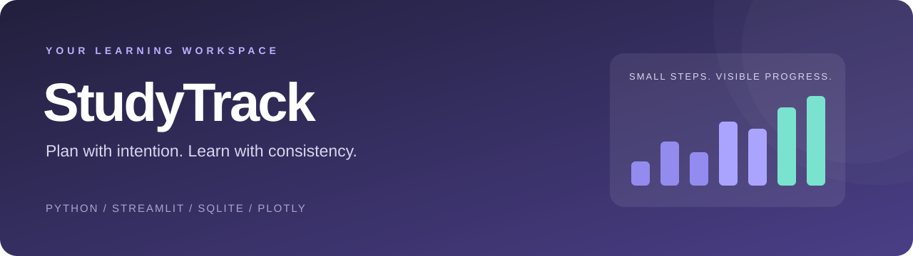
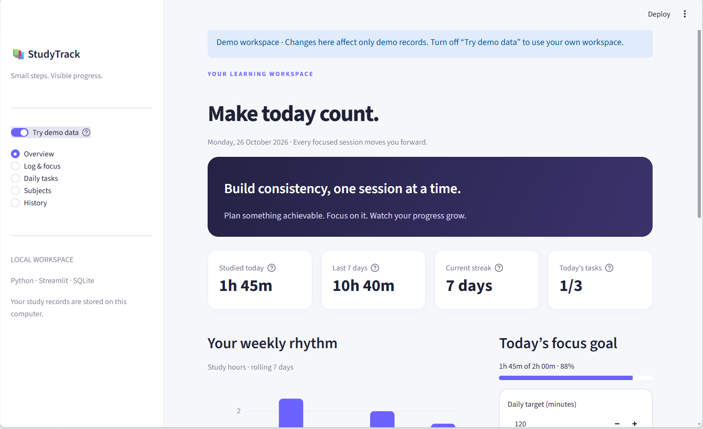
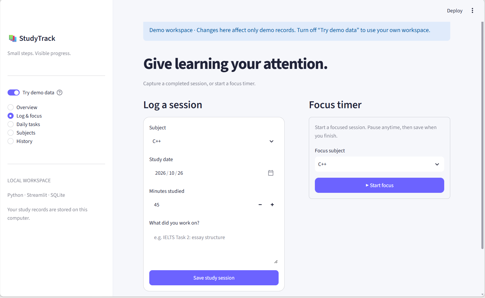
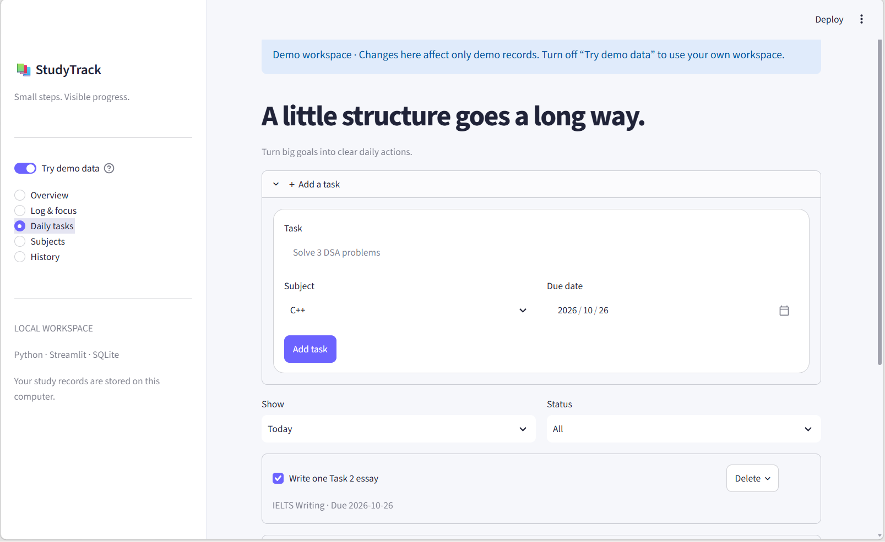
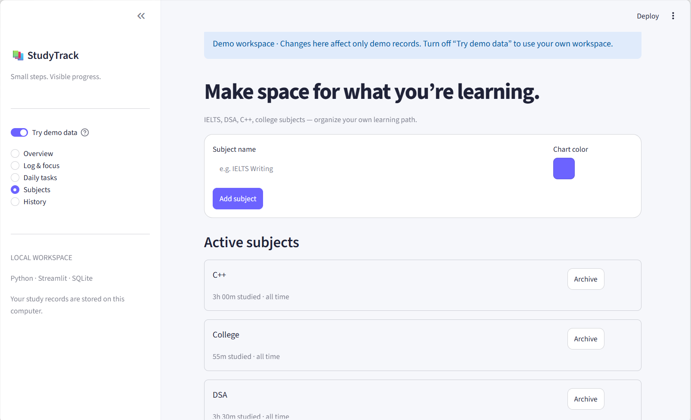
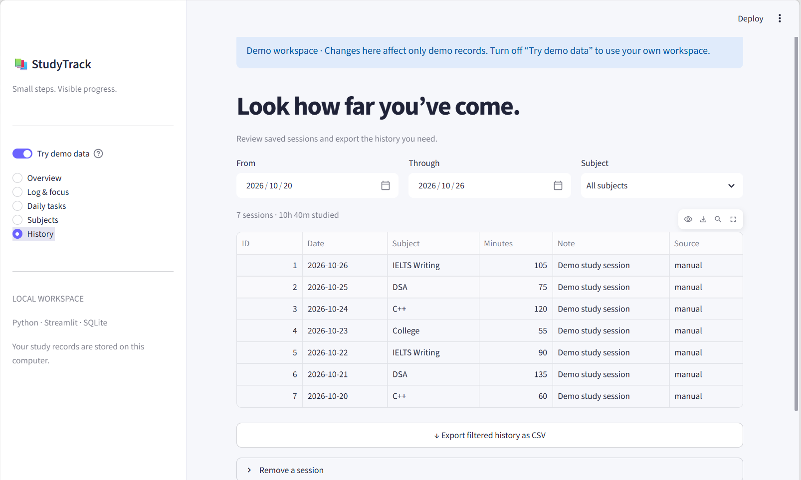

<p align="center"></p>

<p align="center">
  
  
  
  
</p>

# StudyTrack

A personal study planner that turns daily effort into visible progress. Organize subjects, set a study target, capture focused sessions, and review your week in one local workspace.

Built for IELTS preparation, DSA practice, C++, and college subjects. No GPU, API key, or paid service required.

## Features

| Feature | What you can do |
| --- | --- |
| Subjects | Add subjects with chart colors; archive and restore without losing history |
| Daily goals | Set today's time target and track progress toward it |
| Session logger | Record a date, subject, duration, and optional notes |
| Focus timer | Start, pause, resume, save, or discard a session |
| Daily tasks | Set dated tasks; complete, reopen, filter, and remove them |
| Dashboard | See today's time, rolling weekly hours, subject breakdown, and upcoming work |
| Streaks | View current and longest streaks based on saved sessions |
| History & export | Filter by date and subject, delete mistakes, and export CSV |
| Demo workspace | Explore sample IELTS, DSA, C++, and college records separately |

**Example:** log 45 minutes of IELTS Writing and 60 minutes of C++. Today's total becomes **1h 45m**, with both sessions visible in your charts and history.

## Screenshots

Screenshots below show the separate demo workspace with sample study records.

### Progress dashboard



| Session logging & focus timer | Daily task planner |
| --- | --- |
|  |  |

| Subject management | Study history & CSV export |
| --- | --- |
|  |  |

## Quick start on Windows

1. Install **Python 3.11 or newer** from [python.org](https://www.python.org/downloads/). Include the Python launcher when installing.
2. Extract the project ZIP. Open the extracted **StudyTrack-Study-Planner** folder.
3. Double-click **`setup_windows.bat`** once. Internet is required to install packages.
4. Double-click **`run_app.bat`**. Keep its terminal open while using the app.
5. Open **http://localhost:8501** if your browser does not open automatically.

After setup, normal use works offline. To stop the app, press **Ctrl+C** in the terminal.

### Manual setup — Windows

Run these commands inside the project folder:

```bat
py -3 -m venv .venv
.venv\Scripts\python.exe -m pip install -r requirements.txt
.venv\Scripts\python.exe -m streamlit run app.py
```

### Manual setup — macOS / Linux

```bash
python3 -m venv .venv
source .venv/bin/activate
python -m pip install -r requirements.txt
python -m streamlit run app.py
```

## First five minutes

1. On **Subjects**, add `IELTS Writing`, `DSA`, or another subject.
2. On **Daily tasks**, add a measurable goal such as `Solve 3 array problems`.
3. On **Log & focus**, save completed study time or start the timer.
4. On **Overview**, set today's target and review your progress.
5. On **History**, filter sessions and download a CSV.

Turn on **Try demo data** in the sidebar to explore the app before entering your own records. The demo is seeded once, on first use, with dates relative to that day. It is editable, and changes stay in the demo database.

## How progress is calculated

- **Today:** sum of saved session durations assigned to today's date.
- **Weekly chart:** today plus the previous six days, including zero-study days.
- **Current streak:** consecutive dates with any positive saved study duration, ending today or yesterday. If you have not studied yet today, yesterday's streak stays active until today ends.
- **Longest streak:** longest uninterrupted run of study dates in saved history.
- **Tasks:** checklist completion is separate from study time. Completing a task does not automatically create a session.
- **Daily time goal:** defaults to 120 minutes for each new day. Changing it applies to the selected day (today in the UI).

## Data and timer behavior

- Personal data lives in `data/studytrack.db`; demo records use `data/studytrack-demo.db`.
- SQLite files are created automatically. They are excluded from Git so private study records do not enter the repository.
- To back up everything, **stop the app**, then copy the `data` folder somewhere safe. To restore, stop the app and replace that folder with the backup. CSV contains session history only; it does not include subjects, goals, and tasks as a full database backup.
- The optional `STUDYTRACK_DB` environment variable chooses a different personal database path. Demo mode uses a separate sibling file named `studytrack-demo.db`.
- Dates follow the computer/server's local calendar. This app is designed to run locally for one person.
- The timer uses a monotonic clock and excludes pauses. Time while running counts even when the tab is in the background. Save before closing or refreshing the browser; unsaved timers are not persisted.
- A timer session belongs to the date it started. Split overnight study manually if you want to assign time to both dates.
- Each session supports up to 24 hours. Archive hides a subject from new records while preserving its existing tasks and study history.
- The app starts on localhost. Hosted instances have a shared database and no user accounts; hosting requires your own authentication and persistent storage design.

## Project structure

```text
StudyTrack-Study-Planner/
├── app.py                     # Streamlit pages and interface
├── studytrack/
│   ├── db.py                  # SQLite schema, validation, CRUD
│   ├── analytics.py           # Weekly totals, streaks, CSV export
│   ├── timer.py               # Pause/resume stopwatch
│   └── demo.py                # Isolated sample records
├── tests/                     # Core tests and Streamlit interaction tests
├── assets/banner.svg          # Repository banner
├── docs/                      # Architecture and validation notes
├── .streamlit/config.toml     # Theme and local server settings
├── .github/workflows/tests.yml
├── requirements.txt
├── setup_windows.bat
└── run_app.bat
```

## Tests

```bash
python -m pip install -r requirements-dev.txt
python -m unittest discover -s tests -v
```

Tests cover persistence, invalid input, subject archiving, tasks, daily goals, paused time, duplicate timer saves, streak gaps, weekly boundaries, CSV escaping, and demo isolation. Streamlit's `AppTest` also exercises the empty workspace, logging and task flow, navigation, and demo switching. UI tests skip if Streamlit is not installed. GitHub Actions installs dependencies and runs the suite on Python 3.11, 3.12, and 3.13.

See [validation notes](docs/VALIDATION.md) for checks completed when this package was created.

## Add to GitHub

Create an empty repository named **`StudyTrack-Study-Planner`** in your GitHub account. Leave its README, license, and `.gitignore` options unchecked because these files are already included. In the extracted project folder:

```bash
git init -b main
git add .
git commit -m "Initial release of StudyTrack"
git remote add origin https://github.com/RUPEN-18/StudyTrack-Study-Planner.git
git push -u origin main
```

Suggested description: **Personal study planner with focus sessions, daily tasks, streaks, and progress charts using Python, Streamlit, SQLite, and Plotly.**

Suggested topics: `python`, `streamlit`, `sqlite`, `plotly`, `study-planner`, `productivity`, `student-project`.

## Roadmap

- Pomodoro intervals and break reminders
- Recurring tasks and weekly goals
- Session editing and richer subject management
- Authentication and a deployment-ready database for multi-user hosting

## License

[MIT](LICENSE) · Rupendran Manigandan
